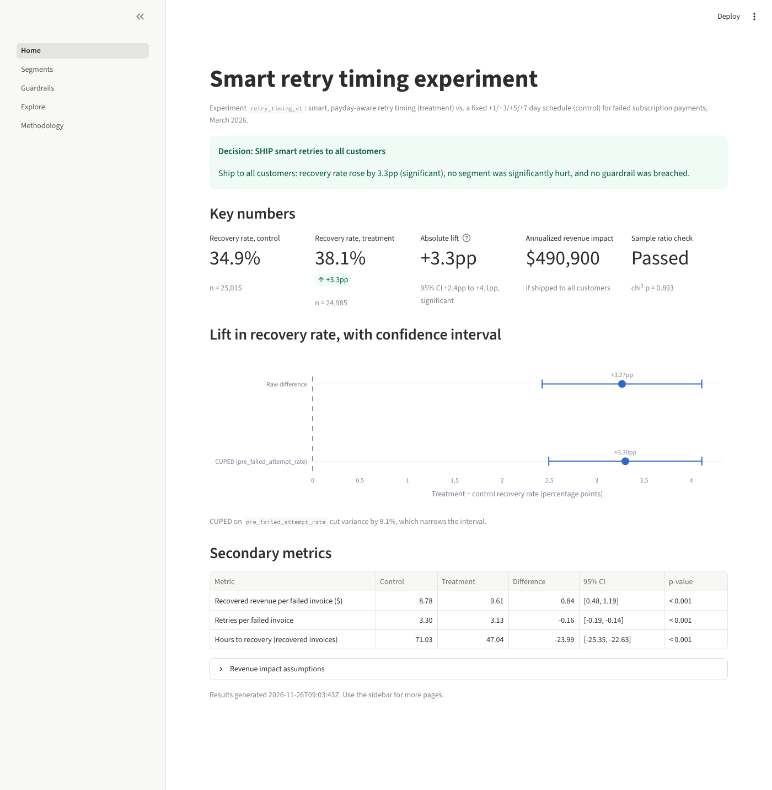
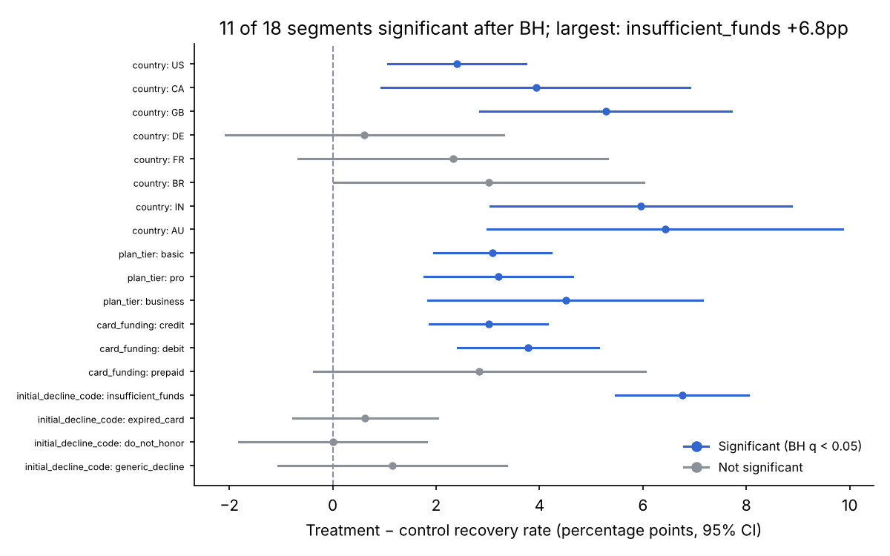
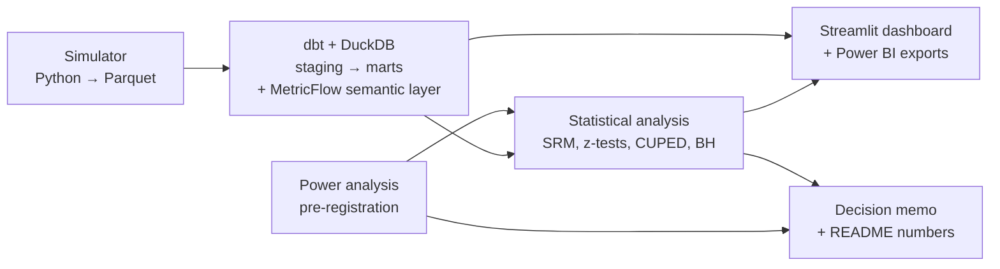
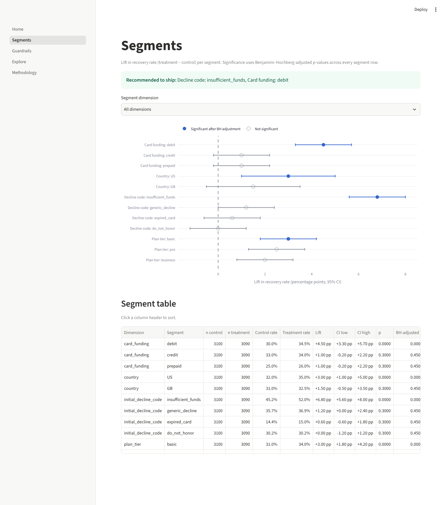
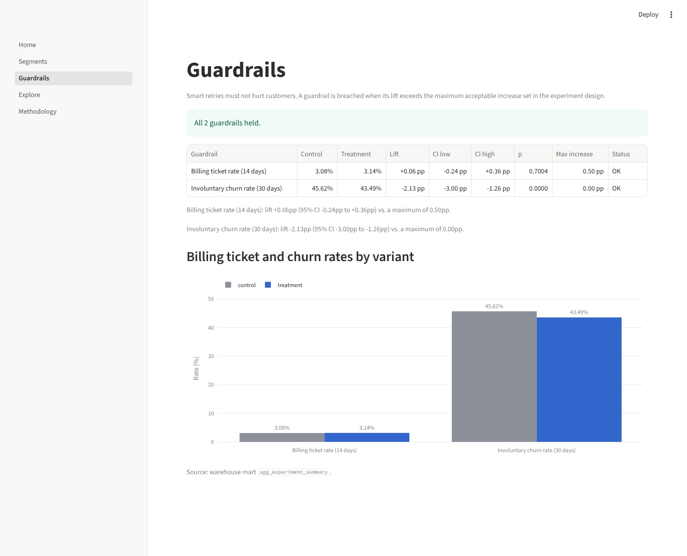
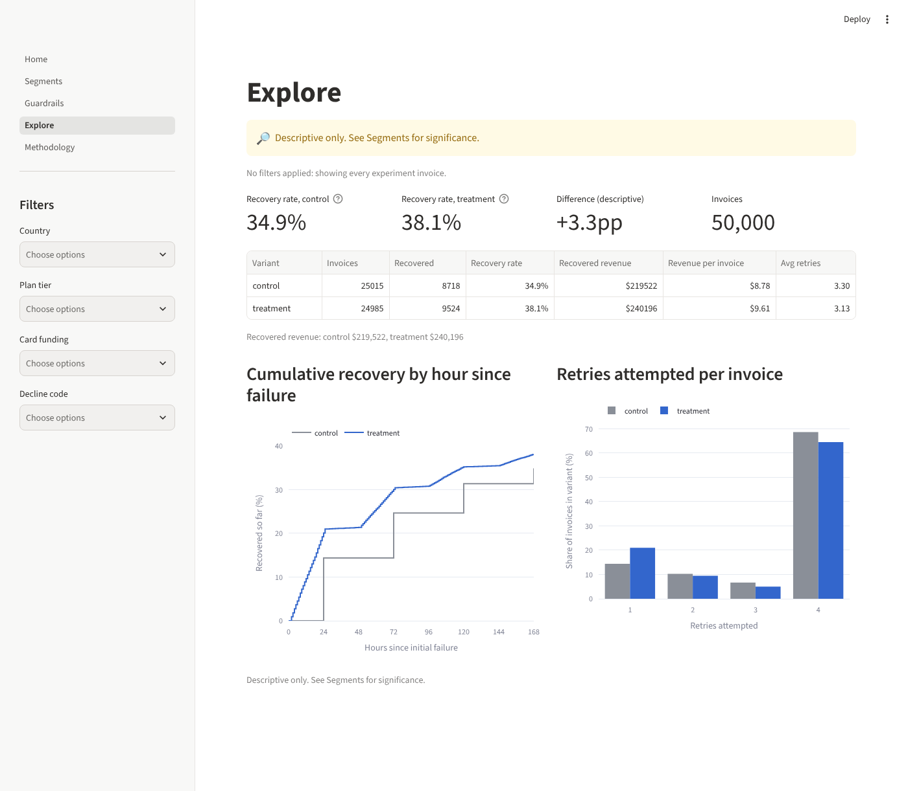
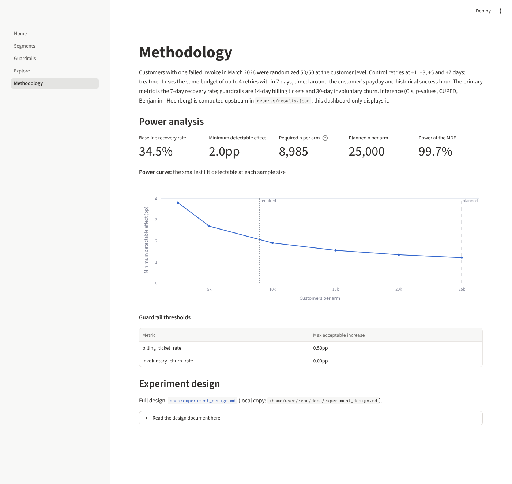

# RetryLab: smart retry timing for failed subscription payments

[](https://github.com/penguinme12345/payment-retry-experiment/actions/workflows/ci.yml)


<!-- BEGIN:headline -->
Smart retry timing moved payment recovery 34.9% → 38.1% (+3.3pp, 95% CI [2.4pp, 4.1pp]), worth an estimated $490,900/yr.
<!-- END:headline -->

An end-to-end experimentation project: a simulated subscription business, an A/B test of
payday-aware "smart" retry timing against a fixed day 1/3/5/7 schedule, a dbt metrics layer with a
semantic layer, a pre-registered statistical analysis, a Streamlit dashboard, and a one-page
decision memo. One command rebuilds all of it from a seed.



## The question

Does retrying failed subscription payments at smart times (just after the customer's payday, at
the hour their card usually succeeds) recover more revenue than a fixed schedule, without hurting
customers? If so, for which segments should we ship it?

## Key results

<!-- BEGIN:key-results -->
| | |
|---|---|
| Decision | Ship to all customers |
| Sample | 25,015 control / 24,985 treatment |
| Recovery rate | 34.9% → 38.1% |
| Lift (95% CI) | +3.3pp [2.4pp, 4.1pp] |
| CUPED lift (95% CI) | +3.3pp [2.5pp, 4.1pp], 8.1% variance reduction |
| SRM check | passed (p = 0.893) |
| Guardrail: billing-complaint tickets within 14 days | +0.06pp (held) |
| Guardrail: involuntary churn within 30 days | -2.13pp (held) |
| Customers declined for insufficient funds | +6.8pp lift |
| Customers paying with a debit card | +3.8pp lift |
| Annualized impact | $490,900 |
<!-- END:key-results -->

The effect is concentrated where the mechanism says it should be: customers declined for
insufficient funds gain the most, while expired-card declines show no effect.



Read the full write-up in the **[decision memo](docs/memo.md)**. Every number above and in the memo
is generated from [`reports/results.json`](reports/results.json) and
[`reports/power_analysis.json`](reports/power_analysis.json); none is typed by hand.

## What I built



| Stage | What it does | Output |
|---|---|---|
| **Simulate** | Seeded generator for customers, invoices, retry attempts, tickets and churn, with known planted effects | `data/raw/*.parquet` |
| **Model** | dbt staging, intermediate and mart models on DuckDB, 84 data tests, MetricFlow metrics | `data/warehouse.duckdb` |
| **Design** | Power analysis and minimum detectable effect, written before looking at results | `reports/power_analysis.json`, [`docs/experiment_design.md`](docs/experiment_design.md) |
| **Analyze** | Sample-ratio check, two-proportion z-tests, CUPED, Benjamini–Hochberg segment cuts, guardrails, revenue sizing, ship decision | `reports/results.json`, `reports/figures/` |
| **Report** | Decision memo, README tables, Streamlit dashboard, Power BI CSVs | `docs/memo.md`, `app/`, `exports/powerbi/` |

## Quickstart

Requires Python 3.11+ and `make`.

```bash
git clone https://github.com/penguinme12345/payment-retry-experiment.git
cd payment-retry-experiment
python -m venv .venv && source .venv/bin/activate
make setup     # install the package and dev tools
make all       # simulate → dbt build → power analysis → analysis → memo → exports (~15s)
make app       # open the dashboard at http://localhost:8501
```

| Command | What it does |
|---|---|
| `make all` | Runs the whole pipeline end to end |
| `make app` | Starts the Streamlit dashboard |
| `make test` | Runs the test suite (unit, dbt, dashboard and end-to-end) |
| `make lint` | Runs ruff |
| `make readme` | Refreshes the generated README blocks from `reports/results.json` |
| `make clean` | Deletes all generated data and reports |

Use `make all SIM_CONFIG=config/sim.ci.yaml` for a quick 5,000-customer run.

## Dashboard

| Segments | Guardrails |
|---|---|
|  |  |
| **Explore** | **Methodology** |
|  |  |

## Skills shown

| Skill | Where it's shown |
|---|---|
| Analyze data and run experiments | Experiment design (power analysis), statistical analysis |
| A/B testing to assess launch impact | Pre-registration, SRM check, CUPED, guardrails, ship decision |
| Extend a metrics semantic layer | dbt semantic models + MetricFlow metrics |
| Build and improve data assets | Raw data simulator, dbt marts with tests |
| Metrics, reports, dashboards | dbt metrics, Streamlit dashboard, Power BI exports |
| Actionable recommendations and data storytelling | Decision memo |
| Writing and debugging data pipelines | Simulator → dbt → analysis, one `make all`, CI |

## Repo tour

```
├── config/                 Simulator configs (50k default, 5k for CI) and planted ground truth
├── src/retrylab/
│   ├── sim/                Deterministic data simulator
│   ├── design/             Power analysis
│   ├── analysis/           SRM, z-tests, CUPED, BH segments, guardrails, decision
│   └── reporting/          Memo, README blocks and summary bullets
├── dbt/                    Staging, intermediate and mart models, tests, semantic layer
├── app/                    Streamlit dashboard and Power BI export
├── reports/                results.json, power_analysis.json, figures
├── docs/
│   ├── memo.md             Decision memo (generated)
│   ├── experiment_design.md  Pre-registration
│   ├── prd/                The specs each component was built from
│   └── handoffs/           Build notes for each component
├── exports/powerbi/        Power BI CSV extracts and guide
└── tests/                  pytest suites per component, plus end-to-end
```

## Limitations

- The data is simulated and the effect sizes are planted, so the results show the method, not a
  real-world finding.
- The revenue estimate rests on the assumptions listed in the memo's caveats.
- One failed invoice per customer is analyzed, so the test can't speak to repeat failures.

## Resume bullets

<!-- BEGIN:bullets -->
- Designed and analyzed a 50,000-customer A/B test of smart payment-retry timing; recovery rate moved +3.3pp (95% CI [2.4pp, 4.1pp], p < 0.001).
- Built a dbt + DuckDB metrics layer and Python stats pipeline with CUPED (8.1% variance cut) and BH-corrected cuts: 11 of 18 segments significant.
- Wrote a decision memo and Streamlit dashboard recommending a full launch, sized at $490,900/yr in recovered revenue.
<!-- END:bullets -->
