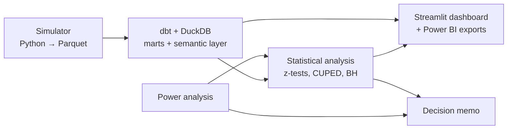

# RetryLab: smart retry timing for failed subscription payments

<!-- BEGIN:headline -->
_Headline result is generated from `reports/results.json` by `make readme` after `make all`._
<!-- END:headline -->

An end-to-end analytics project: a simulated subscription business, an A/B test of payday-aware
"smart" retry timing against a fixed day 1/3/5/7 schedule, a dbt metrics layer, a pre-registered
statistical analysis, a Streamlit dashboard, and a one-page decision memo.

<!-- Screenshots (phase 2): dashboard overview and the segment forest plot. -->

## The question

Does retrying failed subscription payments at smart times (just after the customer's payday, at
the hour their card usually succeeds) recover more revenue than a fixed schedule, without hurting
customers? If so, for which segments should we ship it?

## What I built



## Key results

<!-- BEGIN:key-results -->
_Generated from `reports/results.json` by `make readme`._
<!-- END:key-results -->

Full write-up: [docs/memo.md](docs/memo.md).

## Skills shown

| Posting requirement | Where it's shown |
|---|---|
| Analyze data and run experiments | Experiment design (power analysis), statistical analysis |
| A/B testing to assess launch impact | Experiment design, statistical analysis |
| Extend a metrics semantic layer | dbt semantic models + metrics |
| Build/improve data assets | Raw data simulator, dbt marts |
| Metrics, reports, dashboards | dbt metrics, Streamlit dashboard, Power BI exports |
| Actionable recommendations / data storytelling | Decision memo |
| Writing and debugging data pipelines | Simulator → dbt → analysis, one `make all` |

## Quickstart

```bash
python -m venv .venv && source .venv/bin/activate
make setup all app
```

`make all` runs simulate → dbt build → power analysis → analysis → memo → exports. `make test`
runs the test suite; `make lint` runs ruff.

## Repo tour

| Path | What's there |
|---|---|
| `src/retrylab/sim/` | Deterministic data simulator (seeded) |
| `dbt/` | Staging models, marts, MetricFlow semantic layer |
| `src/retrylab/design/` | Power analysis → `reports/power_analysis.json` |
| `src/retrylab/analysis/` | SRM, z-tests, CUPED, segments with BH → `reports/results.json` |
| `app/` | Streamlit dashboard and Power BI CSV export |
| `src/retrylab/reporting/` | Memo, README numbers, and resume bullets rendered from the results |
| `docs/prd/` | The specs each workstream was built from |

## Limitations

- The data is simulated and the effect sizes are planted, so the results show the method, not a
  real-world finding.
- The revenue estimate rests on the assumptions listed in the memo's caveats.

## Resume bullets

<!-- BEGIN:bullets -->
_Generated by `python -m retrylab.reporting.bullets` after `make all`._
<!-- END:bullets -->
