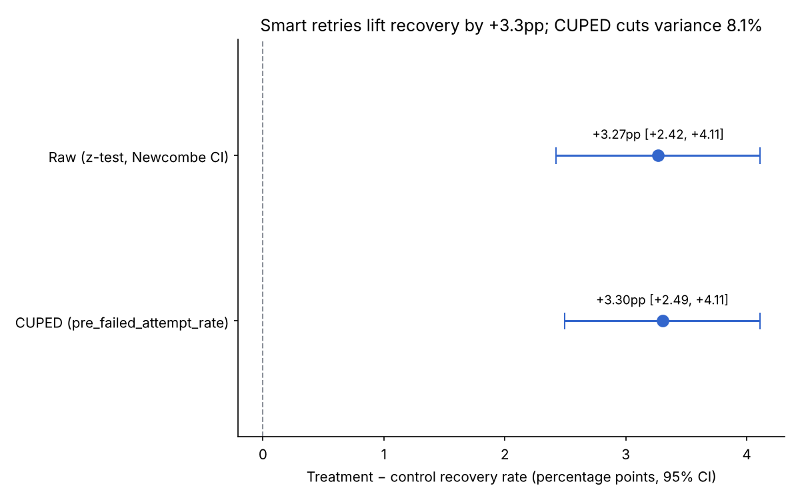
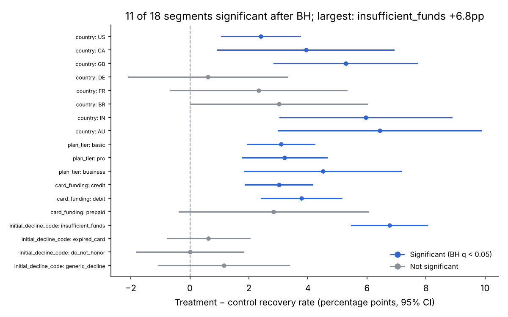
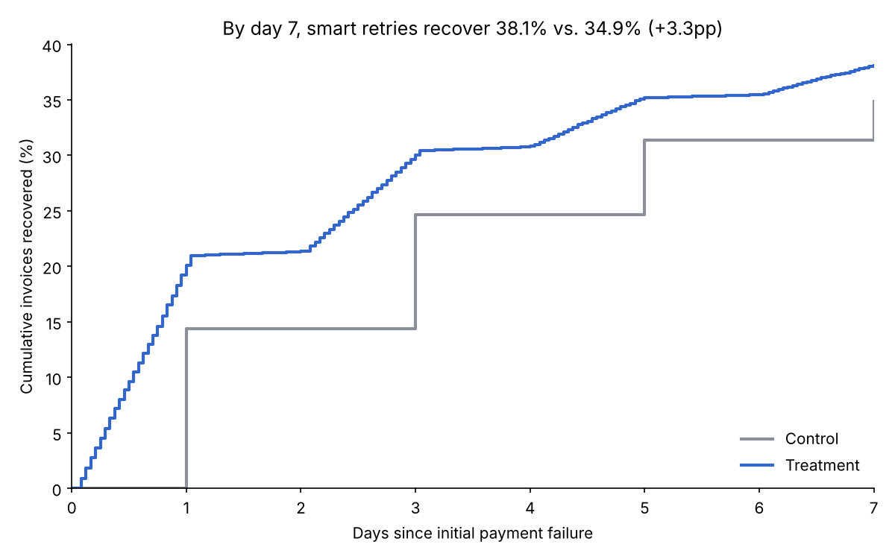
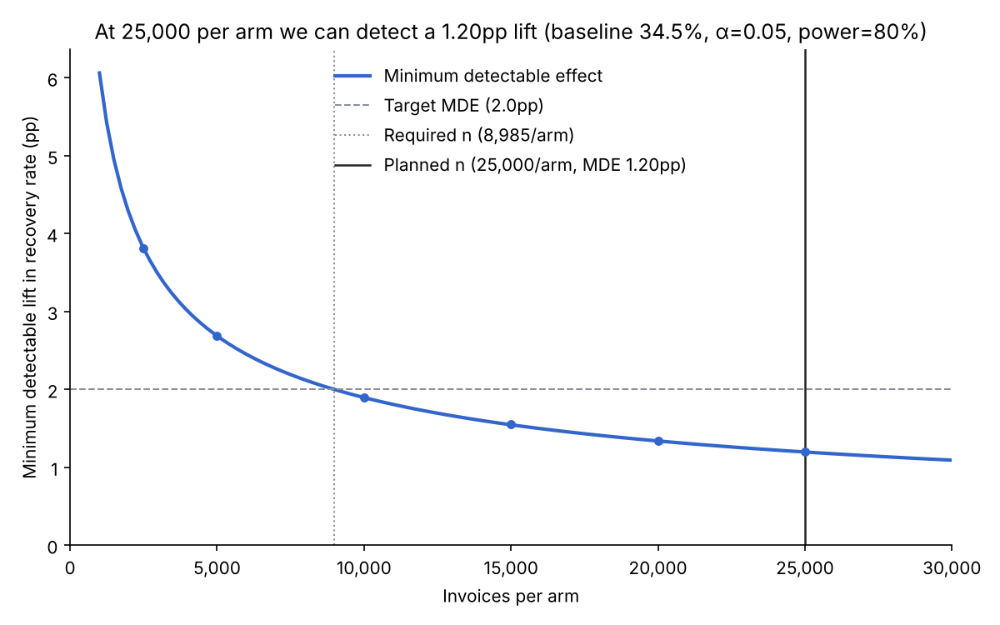

# Smart retry timing: ship to everyone

*Experiment `retry_timing_v1` · 50,000 failed invoices · results generated 2026-11-26T09:03:43Z*

## TL;DR

We recommend shipping smart retry timing to all customers. It raised the payment recovery rate from 34.9% to 38.1%, +3.3pp (95% CI [2.4pp, 4.1pp]), worth an estimated $490,900 a year in recovered revenue, with no guardrail breached.

## What we tested and why

A failed subscription payment gets up to four retries over seven days, today on a fixed day 1, 3, 5, 7 schedule. Smart retries keep the same budget but time it: just after the customer's payday when we know it, at the hour their card usually succeeds. The question: does better timing recover more failed payments without annoying customers?

We randomized 25,015 customers to the fixed schedule and 24,985 to smart retries, one failed invoice each. The test was sized to detect a 2.0pp change from a 34.5% baseline at 80% power (alpha 0.05), which needs 8,985 per arm; we planned 25,000 and hit that plan.

## Results

The recovery rate was 34.9% on the fixed schedule and 38.1% with smart retries: a lift of **+3.3pp** (+9.4% relative), 95% CI [2.4pp, 4.1pp], p < 0.001. The lift is statistically significant.

Adjusting for each customer's pre-period failure rate (CUPED on `pre_failed_attempt_rate`) cut variance by 8.1% and gives +3.3pp, CI [2.5pp, 4.1pp], confirming the raw estimate with a tighter interval.

The traffic split passed the sample-ratio check (p = 0.893), so assignment looks healthy.

- Recovered revenue per failed invoice: $8.78 → $9.61 (+$0.84, CI [$0.48, $1.19], p < 0.001).
- Retries per failed invoice: 3.30 → 3.13 (-0.16, CI [-0.19, -0.14], p < 0.001).
- Hours to recovery (recovered invoices): 71.0h → 47.0h (-24.0h, CI [-25.4h, -22.6h], p < 0.001).

## Where it works

11 of 18 segment cuts improved significantly after Benjamini–Hochberg correction. The strongest evidence:

- Customers declined for insufficient funds recovered 6.8pp more often with smart retries (45.2% → 52.0%, 95% CI [5.5pp, 8.0pp], adjusted p < 0.001; n = 23,005).
- Customers paying with a debit card recovered 3.8pp more often with smart retries (34.2% → 38.0%, 95% CI [2.4pp, 5.1pp], adjusted p < 0.001; n = 19,015).
- Customers on the Basic plan recovered 3.1pp more often with smart retries (34.8% → 37.9%, 95% CI [2.0pp, 4.2pp], adjusted p < 0.001; n = 27,643).
- Customers paying with a credit card recovered 3.0pp more often with smart retries (34.8% → 37.8%, 95% CI [1.9pp, 4.2pp], adjusted p < 0.001; n = 27,403).

There was no significant effect for expired-card declines, do-not-honor declines, and generic declines. That fits the mechanism: timing helps when a customer is briefly short of money, not when the card itself has expired.

## Guardrails

- **Billing-complaint tickets within 14 days:** 3.08% → 3.14% (+0.06pp, CI [-0.24pp, 0.36pp]; limit +0.5pp). Held.
- **Involuntary churn within 30 days:** 45.62% → 43.49% (-2.13pp, CI [-3.00pp, -1.26pp]; no increase allowed). Held.

Customer experience held up: no guardrail moved past its pre-registered limit.

## Recommendation and next steps

**Decision: ship.** Ship to all customers: recovery rate rose by 3.3pp (significant), no segment was significantly hurt, and no guardrail was breached.

Estimated impact: **$490,900 a year** in incremental recovered revenue.

Rollout:

1. Ramp smart retries to 10% of failed invoices for one week and confirm recovery and guardrails match the test.
2. Expand to 50% for a second week, re-checking billing tickets and involuntary churn.
3. Go to 100%, keeping a 5% holdout for a quarter to measure the long-run effect.

What to test next:

- Tune the smart policy for the segments with the smallest lift.
- Test a fifth retry or a longer window for high-value plans.

## Caveats

- The data is simulated, with effect sizes planted by design; the method transfers, the numbers do not.
- Revenue estimate assumes: monthly failed-invoice volume equals the experiment window volume (both arms, one month).
- Revenue estimate assumes: incremental recovery per failed invoice equals the measured absolute lift in recovery rate.
- Revenue estimate assumes: each recovered invoice is worth the segment's average invoice amount (one month of subscription revenue); downstream retention value is excluded.
- Revenue estimate assumes: annualized as 12 × the monthly incremental revenue, with no seasonality or growth.
- Revenue estimate assumes: the lift observed in the experiment persists after launch (no novelty decay).
- Revenue estimate assumes: shipped to all customers, using the overall (unadjusted) lift.

## Figures

*Overall lift in recovery rate, raw and CUPED-adjusted, with 95% CIs.*

*Lift by segment; BH-significant segments highlighted.*

*Cumulative recovery over the 7-day retry window, by variant.*

*Minimum detectable effect vs. sample size per arm.*
